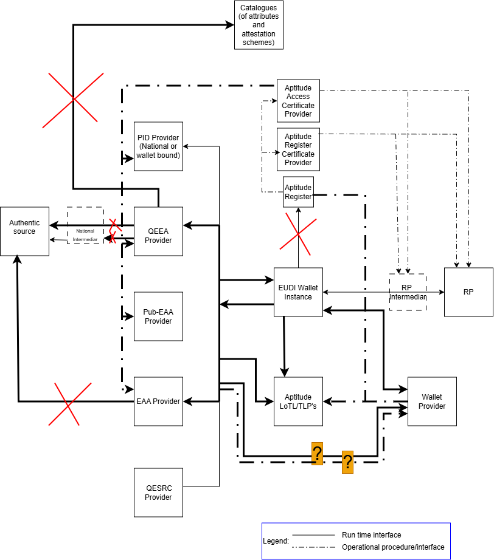
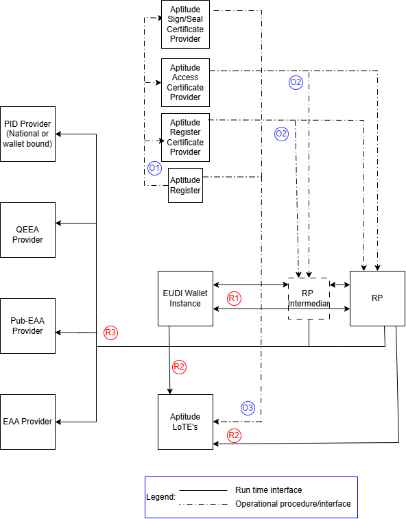
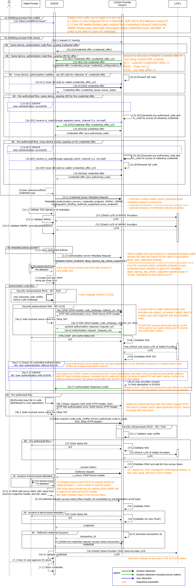

# Generic issuance flow specification

Version 1.1
Date 26-10-2026

## Verion history

| Version# | Date| Description |
|-----------|-------------|-----------|
| 1.1 | 26-10-2026 | Added support for embedded user authentication during the credential issuance process, reformated the mapping section |
| 1.0 | 14-09-2026 | Initial delivery  |

## Authors

1. Aleksandar Simsic, ICTU
2. Nikos Triantafyllou, University of the Aegean
3. Andrea Moro, Fondazione Bruno Kessler

## Reviewers

1. Giancarlo Degani, Infocert
2. Luca Vallone, IPZS
3. ...

## Table of Contents

1. Introduction
2. Aptitude landscape overview
   * 2.1 Relation between different standards and interfaces
3. Interaction details
   * 3.1 Flow requirements
     * 3.1.1 OID4VCI requirements
     * 3.1.2 HAIP requirements
     * 3.1.3 ETSI 119 472-3 requirements
     * 3.1.4 TS3 requirements
     * 3.1.5 Additional Aptitude requirements
   * 3.2 Detailed technical flow description (sequence diagram)
     * 3.2.1 Steps mapping overview

## 1 Introduction

This document is a **non-normative companion** to the APTITUDE horizontal RFC specifications. It provides implementers with a single entry point for the generic credential issuance flow by:

* mapping the APTITUDE issuance flow end-to-end as a sequence diagram
* identifying which RFC section governs each step
* clarifying which interfaces and scenarios are in or out of scope for APTITUDE

It does not define new requirements — those are in the RFCs. In case of conflict between this document and an RFC, the RFC takes precedence.

## 2\. Aptitude landscape overview

Following diagram uses EUDI Wallet ecosystem roles diagram from [ARF 3.0](https://eudi.dev/3.0.0/architecture-and-reference-framework-main/#3-roles-within-the-eudi-wallet-ecosystem) as base and presents adaptations relevant for issuance process within the Aptitude LSP.

Aptitude has several specifics on how the trust framework specific roles are filled in where it differs from the way that the related roles will finally being filled in within the full production setup in the Europe.

Here we are only clarifying which roles and/or interfaces are out of the scope of this flow specification:

| Interface | Description | Rationale |
|-----------|-------------|-----------|
| Authentic Source → Issuer | How the Issuer retrieves data from the national authentic source | Assumed to be resolved at national level by each partner acting as Issuer |
| QTSP → Attribute Catalogue | Citizen-initiated flow where a QTSP validates and issues a VC from scratch | No WP in APTITUDE covers this scenario |
| Wallet → APTITUDE Register (runtime) | Runtime lookup from Wallet to APTITUDE Register | Redundant: WRPRC is provisioned at onboarding time (design-time); registration certificate is becoming mandatory per 2025/848 IA.  *Note: A Wallet Instance MAY still use the Register APIs to:*<ul><li>*Check fresh Entity registration information as a backup to the WRPRC failure,*</li><li>*Check that the Registration certificate obtained by the WRP is bound to the service the Wallet Instance is interacting with.*</li></ul> |

### 2.1 Relation between different standards and interfaces

Following diagram uses Aptitude EUDI Wallet ecosystem diagram as starting point, keeping in the picture just the roles that are relevant for the scope of this flow specification. It labels each interaction between the two roles and classifies each interface as a design time (blue label) or as a runtime (red label) interface.

In following table for each identified interface one or more of the relevant standards are listed. Further down within this flow specification these interfaces and related standards will be further used and referenced.

<table>
<colgroup>
<col style="width: 12%" />
<col style="width: 45%" />
<col style="width: 41%" />
</colgroup>
<thead>
<tr>
<th style="text-align: center;"><strong>Interface</strong></th>
<th style="text-align: center;"><strong>Applicable
standards</strong></th>
<th style="text-align: center;"><strong>Additional comment</strong></th>
</tr>
</thead>
<tbody>
<tr>
<td>O1</td>
<td><a
href="https://github.com/eu-digital-identity-wallet/eudi-doc-standards-and-technical-specifications/blob/main/docs/technical-specifications/ts6-common-set-of-rp-information-to-be-registered.md">TS6</a>,</td>
<td>Register party with its role (Issuer/Wallet Provider)</td>
</tr>
<tr>
<td>O2</td>
<td><a
href="https://www.etsi.org/deliver/etsi_ts/119400_119499/11941108/01.01.01_60/ts_11941108v010101p.pdf">ETSI
TS 119 411-8 ver1.1.1</a>, <a
href="https://www.etsi.org/deliver/etsi_ts/119400_119499/119475/01.02.01_60/ts_119475v010201p.pdf">ETSI
TS 119 475 ver1.2.1</a>, <a
href="https://datatracker.ietf.org/doc/html/rfc5280">RFC 5280</a>, <a
href="https://www.etsi.org/deliver/etsi_en/319400_319499/31941202/02.04.01_60/en_31941202v020401p.pdf">ETSI
EN 319 412-2</a>, <a
href="https://www.etsi.org/deliver/etsi_en/319400_319499/31941203/01.03.01_60/en_31941203v010301p.pdf">ETSI
EN 319 412-3</a>, <a
href="https://www.etsi.org/deliver/etsi_ts/119400_119499/11941206/01.01.01_60/ts_11941206v010101p.pdf">ETSI
TS 119 412-6</a></td>
<td>Distribution of WRPACs, Sign/Seal Certififcates and WRPRCs</td>
</tr>
<tr>
<td>O3</td>
<td><a
href="https://github.com/eu-digital-identity-wallet/eudi-doc-standards-and-technical-specifications/blob/main/docs/technical-specifications/ts2-notification-publication-provider-information.md">TS2</a></td>
<td>Notifying TLP’s for related LoTE’s (Wallet Providers, (Pub-)EAA
Providers, Providers of Access and Register Certificate)</td>
</tr>
<tr>
<td>O4</td>
<td><a
href="https://github.com/eu-digital-identity-wallet/eudi-doc-standards-and-technical-specifications/blob/main/docs/technical-specifications/ts3-wallet-unit-attestation.md">TS3 ver1.5.2</a></td>
<td>Issuing of WUA's (WIA&KA's) for WI as per <a
href="https://eur-lex.europa.eu/legal-content/EN/TXT/PDF/?uri=OJ:L_202601731">CIR 2026/1731</a></td>
</tr>
<tr>
<td>O5</td>
<td><a
href="https://github.com/eu-digital-identity-wallet/eudi-doc-standards-and-technical-specifications/blob/main/docs/technical-specifications/ts3-wallet-unit-attestation.md">TS3 ver1.5.2</a>, <a
href="https://aptitude-consortium.github.io/wp2-trust-specifications/latest/sections/trust-management-lifecycle/#token-status-list-wallet-unit-attestation-profile">APTITUDE Trust management and lifecycle</a>, <a
href="https://datatracker.ietf.org/doc/draft-ietf-oauth-status-list/21/">IETF Token Status List Draft 21</a></td>
<td>Optional scheduled revocation checks by the Issuer against the Wallet Provider's status lists for WIA and KA, as per <a
href="https://eudi.dev/3.0.0/annexes/annex-2/annex-2.02-high-level-requirements-by-topic/#a2322-topic-38-wallet-unit-revocation">ARF Topic 38</a> and requirement WURevocation_19.  <em>Note: As specified in <a href="https://aptitude-consortium.github.io/wp2-trust-specifications/latest/sections/trust-management-lifecycle/#token-status-list-wallet-unit-attestation-profile">the APTITUDE Trust Management and Lifecycle profile</a>, for other attestation types within the APTITUDE profiles:</em><ul><li>Both WIA and KA operational checks SHALL be performed for device-bound credentials when operational monitoring is enabled.</li><li>Only the WIA operational check SHALL be performed for non-device-bound attestations when operational monitoring is enabled.\[^1]</li></ul></td>
</tr>
<tr>
<td>O6</td>
<td><a
href="https://openid.net/specs/openid-4-verifiable-credential-issuance-1_0.html#name-notification-endpoint">OID4VCI ver1.0 notification endpoint</a>, <a
href="../RFCs/RFC001.md#87-notification-interface">RFC001 notification interface</a></td>
<td>Notification channel allowing issuer to get updates related to the previosly issued credential\[^1]</td>
</tr>
<tr>
<td>R1</td>
<td>
<a
href="https://openid.net/specs/openid-4-verifiable-credential-issuance-1_0.html">OID4VCI ver1.0</a>,
<a
href="https://openid.net/specs/openid4vc-high-assurance-interoperability-profile-1_0-final.html">HAIP ver1.0</a>,
<a
href="https://www.etsi.org/deliver/etsi_ts/119400_119499/11947203/01.01.01_60/ts_11947203v010101p.pdf">ETSI
TS 119 472-3 ver1.1.1</a>,
<a
href="https://www.rfc-editor.org/rfc/rfc9449.html">RFC9449</a>,
<a
href="https://datatracker.ietf.org/doc/html/draft-ietf-oauth-attestation-based-client-auth-11">IETF OAuth 2.0 Attestation-Based Client Authentication Draft 11</a>, <a
href="https://openid.github.io/OpenID4VCI/openid-4-verifiable-credential-issuance-1_1-wg-draft.html">OID4VCI ver1.1 Editor's draft 15/10/2026</a>

ISO18013-5, <a
href="https://datatracker.ietf.org/doc/draft-ietf-oauth-sd-jwt-vc/17/">SD-JWT
VC Draft 17</a>, <a
href="https://www.etsi.org/deliver/etsi_ts/119400_119499/11947201/01.01.01_60/ts_11947201v010101p.pdf">ETSI
TS 119 472-1 ver1.1.1</a>
</td>
<td>VCI and supporting standards</td>
</tr>
<tr>
<td>R2</td>
<td><a
href="https://www.etsi.org/deliver/etsi_ts/119600_119699/119602/01.01.01_60/ts_119602v010101p.pdf">ETSI
TS 119 602 ver1.1.1</a>, <a
href="https://www.etsi.org/deliver/etsi_ts/119600_119699/119612/02.04.01_60/ts_119612v020401p.pdf">ETSI
TS 119 612 ver2.4.1</a>, <a
href="https://datatracker.ietf.org/doc/html/rfc5280">RFC 5280</a></td>
<td>Fetching QEAA/Pub-EAA/EAA LoTE's Fetching WRPAC and WRPRC LoTE's from their respective LoTE Providers</td>
</tr>
<tr>
<td>R3</td>
<td><a
href="https://www.etsi.org/deliver/etsi_ts/119600_119699/119602/01.01.01_60/ts_119602v010101p.pdf">ETSI
TS 119 602 ver1.1.1</a>, <a
href="https://www.etsi.org/deliver/etsi_ts/119600_119699/119612/02.04.01_60/ts_119612v020401p.pdf">ETSI
TS 119 612 ver2.4.1</a></td>
<td>Fetching Wallet Providers LoTE</td>
</tr>
<tr>
<td>R4</td>
<td><a
href="https://github.com/eu-digital-identity-wallet/eudi-doc-standards-and-technical-specifications/blob/main/docs/technical-specifications/ts3-wallet-unit-attestation.md#222-transport-of-key-attestation-ka">TS3 ver1.5.2</a></td>
<td>Signing WIA and KA as per <a
href="https://eur-lex.europa.eu/legal-content/EN/TXT/PDF/?uri=OJ:L_202601731">CIR 2026/1731</a></td>
</tr>
<tr>
<td>R5</td>
<td><a
href="https://github.com/eu-digital-identity-wallet/eudi-doc-standards-and-technical-specifications/blob/main/docs/technical-specifications/ts3-wallet-unit-attestation.md#243-pid-provider-and-attestation-provider-responsibilities">TS3 ver1.5.2</a>, <a
href="https://aptitude-consortium.github.io/wp2-trust-specifications/latest/sections/trust-management-lifecycle/">APTITUDE Trust management and lifecycle</a>, <a
href="https://datatracker.ietf.org/doc/draft-ietf-oauth-status-list/21/">IETF Token Status List Draft 21</a></td>
<td>Runtime status and key-storage status checks on WIA/KA; the checks are to be profiled precisely in <a href="../RFCs/RFC004.md">RFC004</a>.</td>
</tr>
</tbody>
</table>

O1-6 interfaces are operational interface where some of them can also be used runtime.
The process behind O1, O2 and O3 is explained in Apptitude on-boarding document, please look here <
[wp2-trust-specifications/docs/topics/onboarding-process.md at main · APTITUDE-Consortium/wp2-trust-specifications](https://github.com/APTITUDE-Consortium/wp2-trust-specifications/blob/main/docs/topics/onboarding-process.md)> for more details.
Interfaces O4 and O5 are used runtime and are shown within the sequence diagram.

Usage of the interface O6 is further explained within the RFC001.

## 3\. Interaction details

In this section generic issuance flow is further detailed by identifying exact API/message or other mechanism that takes place at each step.
After the diagram each step is then linked to the underlying RFC that provides more details on its usage.

### 3.1 Flow requirements

Here is the overview of the requirements taken from identified standard specifications that do have impact on flow diagram provided within this document.

#### 3.1.1 OID4VCI requirements

In follow up table the requirements are listed with decision if it is in the scope or not of this version of the Aptitude issuance flow specification.

|**Requirement**|**Scope decision**|
|-|-|
|Authorization and pre-authorized code flows|In scope\[^2]\[^3]|
|Wallet initiated and issuer initiated flow|In scope|
|Same device and cross-device flow|In scope|
|Immediate and deferred issuance|In scope|
|Nonce Endpoint offered by the issuer|In scope|
|Metadata Endpoint offered by the issuer|In scope|
|Sending credential offer by value and by reference|In scope|
|Notification Endpoint for credential lifecycle mngmt|In scope|

#### 3.1.2 HAIP requirements

Comparing to the OID4VCI the HAIP requirements are stricter on what must
be implemented versus what may be implemented. In the following table
the requirements impacting issuance flow are listed.

|**Requirement**|**Scope decision**|
|-|-|
|Authorization code flow shall be supported|In scope|
|Shall use PKCE with s256 as the code challenge method ([RFC7636](https://www.rfc-editor.org/rfc/rfc7636.txt))|In scope|
|Shall use Pushed Authorization Request – PAR ([RFC9126](https://www.rfc-editor.org/rfc/rfc9126.txt))|In scope|
|Shall support DPOP including DPOP-Nonce HTTP header ([RFC9449](https://www.rfc-editor.org/rfc/rfc9449.txt))|In scope|
|Shall support wallet attestation as OAuth client authentication|In scope|
|Shall support attestation proof type including nonce within KA|In scope|

#### 3.1.3 ETSI 119 472-3 requirements

ETSI profile is delivered on top of HAIP profile to clarify all the
specifics for the EUDI wallet implementation. It includes clarifications
on how different trust and policy checks should take place, something
that is also referenced later within the generic technical flow
(sequence diagram). Follow up table includes therefore requirements
impacting issuance flow and designed validation checks.

|**Requirement**|**Scope decision**|
|-|-|
|Issuer and wallet unit shall support access and registration certificate of (Pub-)EAA provider|In scope|
|Issuer may support inclusion of embedded disclosure policy and wallet unit shall process it|In scope|
|Wallet unit shall include WIA to the push authorization and token endpoint|In scope|
|Wallet unit shall include KA to the credential endpoint when issuing device bound attestation|In scope|
|Holder shall prove the possession of private key associated to the public key in KA|In scope|
|Proofing that the same WSCA/WSCD possesses the private keys associated to the public keys in the WIA and one used for the attestation binding|In scope|
|Issuer metadata shall be signed as per [OID4VCI instructions](https://openid.net/specs/openid-4-verifiable-credential-issuance-1_0.html#name-signed-metadata)|In scope|
|Issuer metadata may include provision of EAA reuse policy|Not in the scope|

#### 3.1.4 TS3 requirements

Latest [IA 2026/1731](https://eur-lex.europa.eu/legal-content/EN/TXT/HTML/?uri=OJ:L_202601731) with Annex Ib and according ARF TS03 specifications introduces following requirements relevant for wallet providers and issuers during the issuance process.

|**Requirement**|**Scope decision**|
|-|-|
|Issuer shall check run time WIA revocation status during the issuance process|In scope|
|Issuer shall check run time KA revocation status during the issuance process of the device bound attestation|In scope|
|Attestation provider issuing revocable attestation may set periodical revocation WIA and KA checks. Checks support decision to revoke an attestation in case the wallet provider revoked the wallet unit or issued key|In scope|

#### 3.1.5 Additional Aptitude requirements

In some cases to simplify implementation for the partners there are number of additional requirements added on the top of all formal standards and specifications

|**Requirement**|**Scope decision**|
|-|-|
|Issuer and wallet unit shall use so called "combined mode" using only DPoP proof, as per [IETF oAuth attestation based client authentication DPoP Combined Mode](https://datatracker.ietf.org/doc/html/draft-ietf-oauth-attestation-based-client-auth-11#name-dpop-combined-mode) |In scope|
|Issuer authorization and resource servers shall mandate using of fresh nonce value within the DPoP |In scope|
|Issuer shall offer Nonce Endpoint  |In scope|
|Issuer shall require a presence of WIA and DPoP header on token endpoint for pre-authorized code flow  |In scope|
|Wallet shall send WIA at the PAR and Token endpoints for Authorization Code Flow, prove possession of the WIA `cnf` key, and Issuers shall validate the WIA signature, expiry, and proof of possession as profiled in [RFC-01](../RFCs/RFC001.md#73-authorisation-endpoint-and-par)|In scope|
|Wallet shall send KA at the Credential Endpoint using the selected proof method, and Issuers shall validate the KA and bind issued credentials to the attested keys as profiled in [RFC-01](../RFCs/RFC001.md#75-credential-endpoint)|In scope|
|Trust anchors for (Q)EAA Providers shall be present in a dedicated LoTE |In scope|
|Authentic Source integration|Not in scope|
|Common Credential Catalogue discovery|Not in scope|
|Issuer and wallet unit may support interactive authorization by using OpenID4VP presentation interaction, as defined by OID4VCI ver1.1 editor's draft |In scope|
|Issuer and wallet unit may support interactive authorization by using web-based or custom interaction, as defined by OID4VCI ver1.1 editor's draft  |Not in scope|

The generic issuance flow does not define an Authentic Source interface or a common Credential Catalogue. A Wallet therefore cannot discover credentials through a shared catalogue; each use case manages its own credential offers and selection.

### 3.2 Detailed technical flow description (sequence diagram)

E2E issuance flow is presented through sequence diagram (SD) and after that each step is linked to the relevant Aptitude profile specification document. Referenced specs are:

* [Aptitude Issuance profile RFC-01](../RFCs/RFC001.md)
* [Aptitude Trust Evaluation RFC-03](../RFCs/RFC003.md)
* [Aptitude Trust Evaluation RFC-04](../RFCs/RFC004.md)
* [Aptitude trust framework](https://aptitude-consortium.github.io/wp2-trust-specifications/latest/trust-framework/)

Within the following diagram we introduce the LoTE Provider endpoint as specified in [RFC003](../RFCs/RFC003.md#71-lote-endpoint). Each entity type (Wallet Provider, PID/Attestation Provider, WRPAC/WRPRC Provider) has a unique LoTE published at a specific endpoint detailed in the Official Journal of Aptitude (OJA), which will be made available by WP2 in piloting. The diagram abstracts these different LoTE endpoints into a single LoTE Provider interaction.

### 3.2.1 Steps mapping overview

| SD step | API/message or process | Step description and references |
| --- | --- | --- |
| 1a | Select issuer | The User starts issuance process by selecting preconfigured issuer within the wallet. See [OIDVCI–H6](https://openid.net/specs/openid-4-verifiable-credential-issuance-1_0.html#appendix-H.6)|
| 1b.2A, 1b.2B1, 1b.2D4 | Credential Offer | The User starts issuance process from the Issuer, it uses same device holding its wallet app. Issuer prepares credential offer and invokes wallet app by passing the whole credential offer within the request or just passing uri reference to it. Additionally, in case of pre-authorized code flow issuance, the issuer authenticates the user and provides through a separate channel `tx_code`. See [RFC-01 6.2.2](../RFCs/RFC001.md#622-credential-offer-creation), [RFC-01 6.2.3](../RFCs/RFC001.md#623-credential-offer-delivery-and-wallet-invocation) and [RFC-01 8.1](../RFCs/RFC001.md#81-wallet-invocation-interface)|
| 1b.2B2, 1b.2C, 1b.2D5, 1b.2E6 | Get Credential Offer | For cross-device and same device flow where wallet receives uri reference to the Credential Offer, it needs to retrieve it from the provided location. See [RFC-01 6.2.3](../RFCs/RFC001.md#623-credential-offer-delivery-and-wallet-invocation) and [RFC-01 8.2](../RFCs/RFC001.md#82-credential-offer-interface)|
| 2.1 | Retrieve credential issuer metadata | Metadata object contains WRPAC and WRPRC and issuer may embed additional disclosure policies that wallet needs to persist and validate during the presentation session with RP. See [RFC-01 6.1.1](../RFCs/RFC001.md#611-configuration-and-discovery) and [RFC-01 8.9](../RFCs/RFC001.md#89-metadata-endpoints)|
| V2.1 | Validate signature of provided metadata| See [RFC-01 7.7](../RFCs/RFC001.md#77-server-metadata)|
| V2.2 | Validate WRPAC| See [Aptitude Authentication Process](https://aptitude-consortium.github.io/wp2-trust-specifications/latest/sections/trust-evaluation-process/#authentication-process) and  [Aptitude WRPAC](https://github.com/APTITUDE-Consortium/wp2-trust-specifications/blob/main/docs/topics/access-certificate.md) |
| V2.3, V2.5, V4a.3, V5.4, V6.4 | Get LoTE | See [LoTE Validation Process](https://aptitude-consortium.github.io/wp2-trust-specifications/latest/sections/trust-evaluation-process/#list-of-trusted-entities-validation-process) and  [RFC-03 LoTE Endpoint](../RFCs/RFC003.md#71-lote-endpoint) |
| V2.4 | Validate WRPAC| See [Aptitude Authorization Process](https://aptitude-consortium.github.io/wp2-trust-specifications/latest/sections/trust-evaluation-process/#authentication-process) and  [Aptitude WRPAC](https://aptitude-consortium.github.io/wp2-trust-specifications/latest/sections/trust-artifacts/#wallet-relying-party-access-certificate) |
| 2.2 | Process Embedded Policy | See [Aptitude embedded disclosure policies](https://github.com/APTITUDE-Consortium/wp2-trust-specifications/blob/main/docs/topics/embedded-disclosure-policy.md)|
| 2.3 | Retrieve Authorization server metadata | Note that issuer signals to the wallet its support for interactive authorization by providing `authorization_challange_endpoint`. See [RFC-01 8.9](../RFCs/RFC001.md#89-metadata-endpoints)|
| 3 | Create WIA | See [TS3 2.3.1](https://github.com/eu-digital-identity-wallet/eudi-doc-standards-and-technical-specifications/blob/main/docs/technical-specifications/ts3-wallet-unit-attestation.md#231-content-of-wia)|
| 3.1, 4a.2, 4b.2, 4c.2, 6.2 | Create DPoP | See [IETF OAuth 2.0 Attestation-Based Client Authentication Draft 11 section 5.2](https://datatracker.ietf.org/doc/html/draft-ietf-oauth-attestation-based-client-auth-11#section-5.2)|
| 4a.1, 4a.3 | PAR request |  See [RFC-01 6.1.3](../RFCs/RFC001.md#613-pushed-authorisation-request-par) and [RFC-01 8.3](../RFCs/RFC001.md#83-par-endpoint). Note that Issuer Authorization server forces fresh nonce value usage by providing initially error response as specified in RFC-01 6.1.3 item 4 and [RFC9449 section 8](https://www.rfc-editor.org/info/rfc9449/#section-8)|
| V4a.1, V5.2 | Validate WIA | See [Sign/Seal Certificate Path Validation](https://aptitude-consortium.github.io/wp2-trust-specifications/latest/sections/trust-artifacts/#signseal-certificate-path-validation) |
| V4a.2, V5.3, V6.3 | Get Status list | See [Token Status List](https://aptitude-consortium.github.io/wp2-trust-specifications/latest/sections/trust-management-lifecycle/#token-status-list) |
| V4a.4, V5.5, V6.1 | Validate DPoP | See [IETF OAuth 2.0 Attestation-Based Client Authentication Draft 11 section 7.3](https://datatracker.ietf.org/doc/html/draft-ietf-oauth-attestation-based-client-auth-11#section-7.3)|
| 4a.4 | Authorization request |  Wallet redirects user session to the Issuer  `request_uri` received from the PAR response. See [RFC-01 6.1.4 step 1](../RFCs/RFC001.md#614-user-authorisation) |
| 4a.5-1, 4a.5-2 | User authorization |  Isuer determines how it wishes to authenticate user. Two options are shown in the sequence diagram. See also [RFC-01 6.1.4 step2](../RFCs/RFC001.md#614-user-authorisation) |
| 4a.4 | Authorization response |  Wallet redirects user session back to the wallet app including authorization `code`. See [RFC-01 6.1.4 step 4](../RFCs/RFC001.md#614-user-authorisation) |
| 4b, 4b1 | Pre-authorized code process |  Wallet prompts user to provide separately received `tx_code` prior it can send the token request. Note that Issuer Authorization server forces fresh nonce value usage by providing initially error response as specified in [RFC9449 section 8](https://www.rfc-editor.org/info/rfc9449/#section-8) and [RFC-01 6.2.6 item 3](../RFCs/RFC001.md##626-pre-authorised-code-flow-variant)|
| 4c.1, 4c.3 | Authorization Challange Request | On first (so called initial request) the Isuuer Authorization server returns HTTP 403 error response. Within the Aptittude, attribute `interaction_type_required` will always hold value of `urn:openid:dcp:ia:openid4vp_presentation:` within the response. Issuer will further within the response indicate wich attestation type and claims it wishes to receive with subsequent request (so called intermediate request). See [RFC-01 6.1.4](../RFCs/RFC001.md##64-interactive-authorization-flow) and [RFC-01 8.10](../RFCs/RFC001.md#810-authorization-challenge-endpoint). <mark>Attention</mark> Sequence diagram does not show expected behaivior of Issuer Authorization server forcing fresh nonce value usage by providing initially error response as specified in RFC-01 6.1.3 item 4 and [RFC9449 section 8](https://www.rfc-editor.org/info/rfc9449/#section-8)|
| 5 | Token request |  See [RFC-01 6.1.5](../RFCs/RFC001.md#615-token-request), [RFC-01 6.2.6](../RFCs/RFC001.md#626-token-request-pre-authorised-code-grant)  and [RFC-01 8.4](../RFCs/RFC001.md#84-token-endpoint) |
| 6 | Nonce Request| See [RFC-01 8.6](../RFCs/RFC001.md#86-nonce-endpoint)|
| 6.1 | Create KA | See [TS3 2.3.2](https://github.com/eu-digital-identity-wallet/eudi-doc-standards-and-technical-specifications/blob/main/docs/technical-specifications/ts3-wallet-unit-attestation.md#232-content-of-key-attestation-ka), [RFC-01 7.5.1](../RFCs/RFC001.md#751-credential-request-using-proofsjwt) and [RFC-01 7.5.2](../RFCs/RFC001.md#752-credential-request-using-proofsattestation)|
| 6.3 | Credential request |  See [RFC-01 6.1.6](../RFCs/RFC001.md#616-credential-request), [RFC-01 6.2.7](../RFCs/RFC001.md#627-credential-request)  and [RFC-01 8.5](../RFCs/RFC001.md#85-credential-endpoint) |
| V6.2 | Validate KA | See [Sign/Seal Certificate Path Validation](https://aptitude-consortium.github.io/wp2-trust-specifications/latest/sections/trust-artifacts/#signseal-certificate-path-validation) and [TS3 2.5.2](https://github.com/eu-digital-identity-wallet/eudi-doc-standards-and-technical-specifications/blob/main/docs/technical-specifications/ts3-wallet-unit-attestation.md#252-ka-revocation) |
| 6.5 | Deferred Credential request |  See [RFC-01 6.3](../RFCs/RFC001.md#63-deferred-credential-request), [RFC-01 7.6](../RFCs/RFC001.md#76-deferred-credential-endpoint)  and [RFC-01 8.8](../RFCs/RFC001.md#88-deferred-credential-endpoint) |

\[^1]: Scheduled statuslist checks on WIAs/KAs and attestation life cycle event notifications from wallet instance towards Issuer are not showned within the sequence diagram, as they do not occur during the actual credential issuance process.

\[^2]: Note that wallet must implement both code flows, the issuer may choose to implement only one.

\[^3]: Note that pre-authorized code flow doesn’t meet requirements for issuing the attestation with Level of Assurance HIGH.
